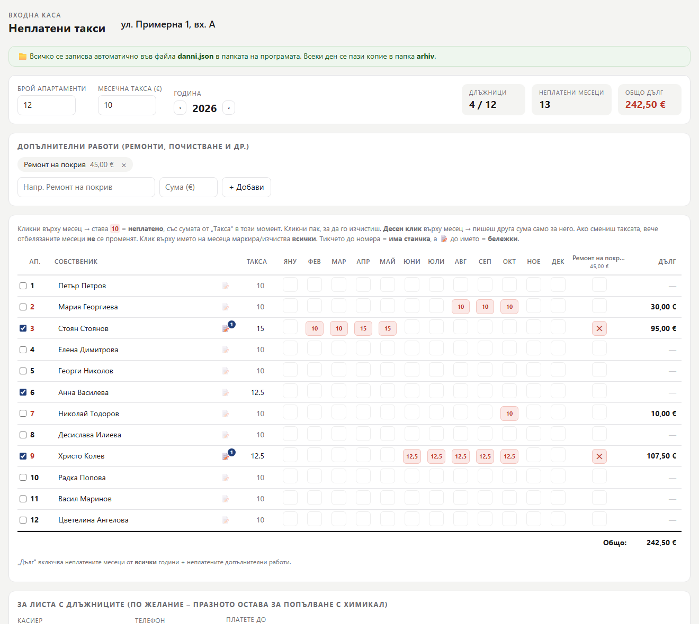
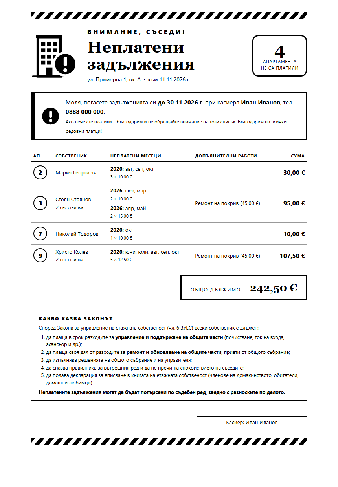
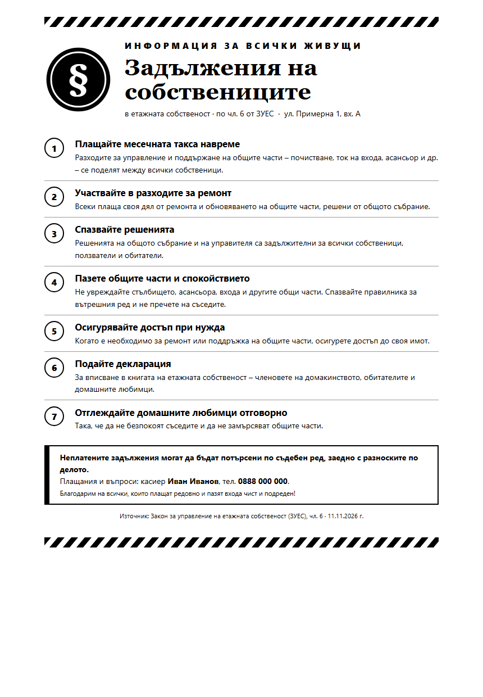

# 🏢 Неплатени такси

**Мега лесна програмка за касиера на входа.** Отбелязваш кой апартамент кой месец не е платил, а тя смята дълговете и печата черно-бял лист с длъжниците, който се забелязва на таблото във входа.

Без инсталиране, без интернет, без акаунти. Работи на всеки компютър с Windows и с всеки браузър (Firefox, Chrome, Edge).

## Какво може

- **Таблица по месеци.** Клик върху месеца го отбелязва като неплатен. Отбелязаният месец помни сумата, която е била таксата тогава, и не се преизчислява, ако по-късно смениш таксата.
- **Различна такса за всеки апартамент.** Десен клик върху месец позволява да зададеш друга сума само за него.
- **Допълнителни работи** като ремонт на покрив или почистване, отделно за всеки апартамент.
- **Тикче „има стаичка“** до номера на апартамента.
- **Бележки** с дата за всеки апартамент (📝), например „обеща да плати до 15-ти“.
- **Автоматично смятане** на дълга за всеки апартамент, на общата сума и на броя длъжници.
- **Два вида печат, черно-бели** и четливи и на най-евтиния принтер:
  - **Лист с длъжниците**, оформен като обява за таблото във входа (бележките не излизат на него).
  - **Годишна таблица** с всички апартаменти, в хоризонтален формат, с бележките най-отдолу.
  - **Задълженията на собствениците** по чл. 6 от ЗУЕС: отделен лист за таблото. По желание основните задължения може да се добавят и на листа с длъжниците.
- **Записва всичко сама** във файл на диска. Освен това всеки ден пази копие на данните.

| Лист с длъжниците | Задълженията по ЗУЕС |
| :---: | :---: |
|  |  |

Снимките са с измислени имена и адрес.

## Как се пуска

1. Изтегли програмата: зеленият бутон **Code → Download ZIP**. Разархивирай я в папка, например на работния плот.
2. Пусни **`Start.bat`** с двоен клик. Програмата се отваря сама в браузъра.
3. Попълни адреса, броя апартаменти и таксата и започни да отбелязваш.

> Първия път Windows може да попита дали да пусне файла. Избери **„Още информация“ → „Изпълни“**.

Когато затвориш таба, програмата спира сама след около 10 минути.

## Къде са данните

| Файл / папка | Какво е |
| --- | --- |
| `danni.json` | Всичките ти данни. Създава се при първото пускане. |
| `arhiv/` | Автоматично копие за всеки ден (`danni-2026-11-11.json` …). |

- Данните **не излизат от компютъра ти**. Програмата работи само на `127.0.0.1` и не се свързва с интернет.
- За да я преместиш на друг компютър или флашка, копирай **цялата папка**.
- С бутона **„💾 Резервно копие“** сваляш копие, а с **„📂 Зареди копие“** го връщаш.
- `danni.json` и `arhiv/` са изключени от git (`.gitignore`), така че личните данни на съседите не попадат в репото.

## Съвети за печат

- Във Firefox, в прозореца за печат, изключи **„Колонтитули“** (Headers and footers), за да не излизат адресът и датата в ъглите.
- Листът е нарисуван с линии и SVG, затова черното излиза и когато браузърът не печата фонове.
- В карето **„За листа с длъжниците“** може да попълниш касиер, телефон и краен срок. Ако ги оставиш празни, на листа излизат черти за попълване с химикал.

## Как е направена

| Файл | Роля |
| --- | --- |
| [`Neplateni.html`](Neplateni.html) | Цялата програма: един HTML файл с вграден CSS и JavaScript, без библиотеки. |
| [`server.ps1`](server.ps1) | Малък локален сървър на PowerShell (вграден във Windows). Отваря страницата и записва `danni.json`. Слуша само на `127.0.0.1:47123` и отказва заявки от други сайтове. |
| [`Start.bat`](Start.bat) | Пуска сървъра скрито и отваря браузъра. |

Ако отвориш `Neplateni.html` директно, без `Start.bat`, програмата пак работи, но данните се пазят само в браузъра. Тогава горе излиза предупреждение.

## Лиценз

[MIT](LICENSE). Свободна е за ползване и промяна, включително от други входове и етажни собствености.
